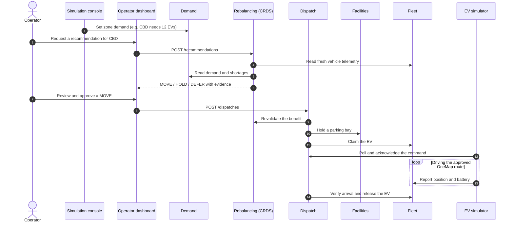

# Autonomous EV Fleet Rebalancing

A distributed, simulation-only system that helps a human dispatcher move
electric vehicles between six Singapore zones (Jurong East, Woodlands, Bishan,
Punggol, Tampines and CBD) so cars are available where customers need them.

Separate services track simulated vehicle telemetry, zone demand, parking and
charging capacity. A recommendation engine decides whether a relocation would
reduce fleet-wide shortage. Nothing moves until an operator explicitly approves
it, and then simulated EVs drive the approved road route. Optional integrations
pull in real car park, charger, traffic and routing data, but **no real vehicle
is ever controlled**.

This is coursework for CSC3104 Cloud and Distributed Computing. It shows
independent services that own their own state, idempotent APIs, optimistic
claims, fail-closed persistence, recovery from uncertain outcomes, and
deployment on Kubernetes.

## How it works



- **Recommendations are advice.** CRDS (Counterfactual Rebalancing under Delayed
  State) compares each candidate move against doing nothing across several
  possible futures, and answers MOVE, HOLD or DEFER.
- **Approval is explicit.** Only `POST /api/v1/dispatches` starts a relocation,
  and Dispatch rechecks everything before claiming the vehicle.
- **Missing data is never guessed.** Stale telemetry, demand or routes make a
  vehicle ineligible or the decision DEFER.

## Tech stack

| Area | Technology |
|---|---|
| Backend services | Python 3.12, FastAPI, Pydantic v2, httpx, Uvicorn |
| Storage | PostgreSQL 17 (JSONB snapshots, telemetry history), Redis (display and traffic cache) |
| Operator dashboard | React 19, TypeScript, Vite, Leaflet, served by nginx |
| Simulation console | React frontend with its own FastAPI backend |
| Deployment | Docker, Docker Compose, Kubernetes (Docker Desktop) with Kustomize |
| Testing | pytest, Vitest, Playwright, GitHub Actions (manual) |
| External data (optional) | LTA DataMall (car parks, chargers, traffic), OneMap (road routes) |

## Getting started

You need Docker Desktop with Kubernetes enabled, `kubectl`, Python 3.12+ and
Git. Node.js 22+ is only needed for frontend development.

| Platform | Guide |
|---|---|
| Windows | [docs/setup-windows.md](docs/setup-windows.md) |
| macOS | [docs/setup-macos.md](docs/setup-macos.md) |

In short:

```sh
git clone https://github.com/shauniee/Autonomous-EV-Fleet-Rebalancing.git
cd Autonomous-EV-Fleet-Rebalancing
cp .env.example .env
bash scripts/start-kubernetes.sh        # Windows: .\scripts\start-kubernetes.ps1
```

Then open:

- **Operator dashboard:** <http://127.0.0.1:8080>, to view the fleet, request
  recommendations and approve relocations
- **Simulation console:** <http://127.0.0.1:8090>, to set demand and start
  rentals, traffic events and load experiments

The default `.env` runs without credentials in offline demo mode (straight-line
routes). For real roads and live data, add a OneMap token and an LTA DataMall
key; see [configuration](docs/configuration.md). The
[demo flow](docs/simulation-console.md#typical-demo-flow) walks through a full
relocation.

## Project structure

```text
src/ev_fleet/          Python backend: every service, sharing one container image
  fleet/               Vehicles, telemetry, rentals, charging tasks and vehicle claims
  demand/              Zone demand, heat map and the demand generator
  rebalancing/         CRDS and legacy recommendations, batches, traffic, charger advice
  dispatch/            Approval, relocation commands, reconciliation and recovery
  facilities/          Car parks, chargers, parking holds and cable handoff
  simulator/           Simulated EVs that report telemetry and drive approved routes
  simulations/         Customer rental workload
  contracts/           Shared Pydantic API models
  common/              Settings, clock, persistence and travel maths
dashboard/             Operator dashboard (React + Leaflet) and its nginx config
simulation-console/    Simulation console (FastAPI backend + React frontend)
k8s/                   Kubernetes manifests (Kustomize) and optional rental workloads
tests/                 pytest unit and integration tests and in-process test helpers
scripts/               Setup, startup, test and evaluation scripts
experiments/           Offline evaluation code (CRDS decision study, strategy and traffic comparisons)
results/               Saved output of those evaluations
docs/                  Architecture, deployment, setup and concept guides
.github/workflows/     Manual CI: infrastructure and Kubernetes portability checks
Dockerfile             Backend image
compose.yaml           Docker Compose alternative to Kubernetes
pyproject.toml         Python package metadata and dependencies
requirements.lock      Pinned backend dependencies for the image
.env.example           All supported settings, with credential-free defaults
```

## Documentation

Start with the [documentation index](docs/README.md). Key guides:

- [Architecture](docs/architecture.md): services, ownership, consistency and failure handling
- [Docker, nginx and Kubernetes](docs/deployment.md)
- [Simulation console and operator dashboard](docs/simulation-console.md)
- [CRDS](docs/crds.md) and [dispatch lifecycle](docs/dispatch-relocation.md)
- [API contracts](docs/api-contracts.md)
- [Local testing](docs/local-testing.md)

## Testing

```sh
.venv/bin/python -m pytest -q                       # backend
npm --prefix dashboard test -- --run                # dashboard and console UI
npm --prefix dashboard run build
```

On Windows, `.\scripts\test-local.ps1` runs all of these. See
[local testing](docs/local-testing.md) for integration checks and environment notes.

## Limitations

- Simulation only: demand, movement, rentals and charging are simulated, and
  parking holds are not real reservations.
- No authentication. Run it locally and never expose the services or the
  simulation console to an untrusted network.
- State-owning services run as a single replica each; only the dashboard scales out.
- Real LTA and OneMap data improve realism but do not make this a real
  autonomous or vehicle-control system.
